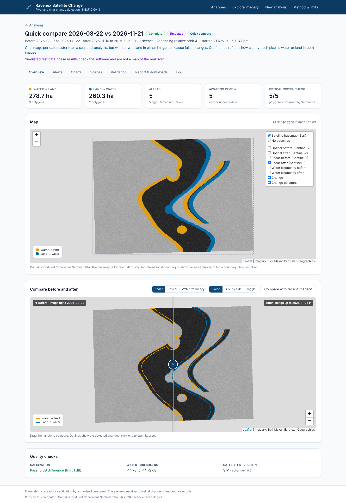
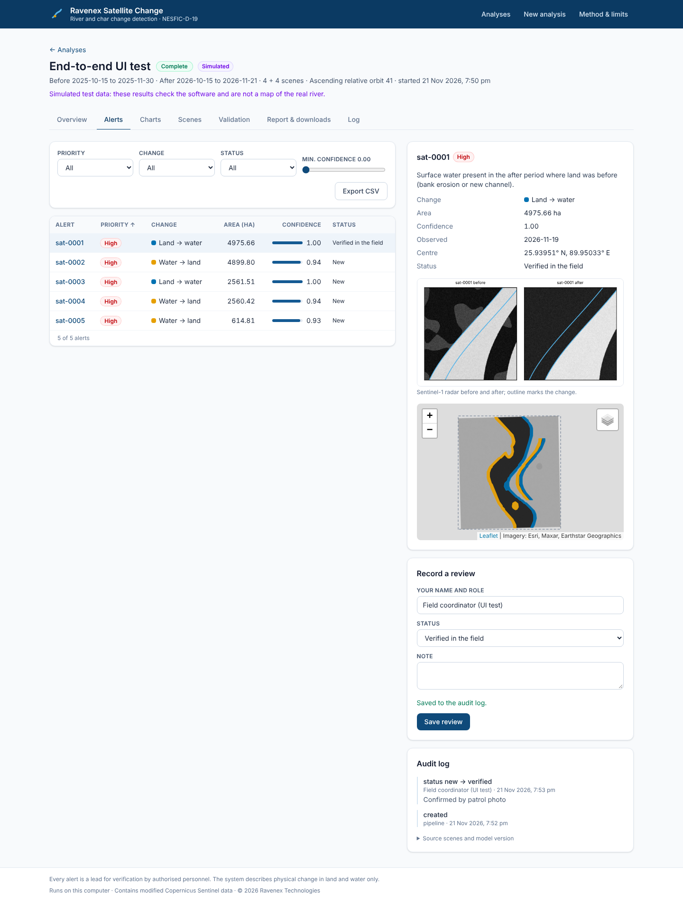

# Ravenex Satellite Change Map

**Satellite change detection module for NESFIC-D-19: AI-Enabled Integrated Border Surveillance and Illegal
Intrusion Detection Using Satellite, UAV and Ground-Based Sensors** (challenge owner: ASSAC, Department of
Science & Technology, Government of Assam).

This software maps where river channels and sand islands (chars) changed between two seasons, using free
Sentinel-1 radar images that see through cloud. Each change becomes a prioritised alert with a confidence
level, evidence, timestamps and an audit trail, ready for verification by authorised personnel.

Ravenex Technologies built this module in November 2026 as proof of work for NESFIC-D-19. It is the satellite
component of the integrated platform described in our proposal, which will add UAV video and ground-sensor
feeds to the same alert queue.

> **Human-in-the-loop by design.** Every alert is a lead for verification by authorised personnel. The
> software describes physical change in land and water only. It does not determine causes, and it does not
> detect or label people.

---

## Check it yourself in 10 minutes (no account needed)

Requires Git and Python 3.11 or newer on Windows, macOS or Linux. Node.js is **not** needed: the web app is
included already built.

```bash
git clone <this repository URL>
cd ravenex-satellite-change   # the folder git created
python -m venv .venv
# Windows:     .venv\Scripts\activate
# macOS/Linux: source .venv/bin/activate
pip install -r requirements.txt

python serve.py            # opens the web app at http://localhost:8000
```

In the web app, click **New analysis**, choose **Simulated demo** and press **Run full analysis**. In about
3 minutes you get the full result: map, alerts, charts, validation and the PDF report.

The demo builds a simulated braided river on the real analysis grid around Dhubri. Between the two periods,
a channel shifts and a sand island grows. It includes two deliberate traps:

- **Wind:** one "before" scene has wind on the water, which makes water look like land on radar.
- **Wet sand:** one "after" scene has a wet sandbar, which makes land look like water.

The pipeline is then scored against the known answer. Results from our run (Python 3.13, Linux, 155 seconds):

| Change class | Precision | Recall | True area | Mapped area |
| --- | --- | --- | --- | --- |
| Water became land | 1.000 | 0.999 | 8,079.9 ha | 8,075.0 ha |
| Land became water | 1.000 | 1.000 | 7,538.7 ha | 7,537.2 ha |

Both traps were rejected; the windy scene stands out on the Charts page. To reproduce the score from the
command line, run `python run.py --demo` and open `output_demo/synthetic_truth_score.json`. Demo results are
marked SIMULATED everywhere: they test the software and are not results for the real river.

**Automated tests:** `python -m pytest -q` runs 13 tests in about 1.5 minutes. They check:

- the speckle filter, thresholding, change rules, small-patch removal, grid and config checks
- an end-to-end run that must reach at least 90% precision and recall
- that two runs give identical polygons
- the web API: rejecting bad input and unsafe file paths, a full run, an alert review written to the audit log,
  validation scoring, a quick two-date comparison, and imagery tiles (request contents, date window, caching),
  with the Copernicus service mocked

## The web app

```bash
python serve.py                        # http://localhost:8000, opens your browser
python serve.py --port 9000 --no-browser
```

The app has a React frontend and a Python API (FastAPI) that wraps the same pipeline as `run.py`. By default
it listens only on this computer (`127.0.0.1`). It sends no usage data anywhere, and the map and chart
libraries are bundled, so nothing loads from outside except the satellite basemap and the Copernicus imagery.

| Page | What you can do |
| --- | --- |
| Analyses | See every analysis with its status, area changed and alert count |
| Explore imagery | Browse Sentinel-1 radar or Sentinel-2 optical imagery for any date and compare two dates: 1 week, 20 days, 1 month, 3 months or 6 months back, or a custom date. Choose swipe, side by side or toggle, overlay the detection outlines from any analysis, and see which image dates were actually used. One click runs a quick change detection for the area in view. |
| New analysis | Draw the area on the map or type its corners, pick the two periods, choose real Sentinel-1 data, the simulated demo or your own files, and start. You can first find scenes only, check them, then run the full analysis with the same settings. |
| Overview | Totals, an interactive map (radar, water frequency, Sentinel-2 optical and change layers, clickable change polygons), a swipe map comparing before and after with the detection outlines on top, and quality checks |
| Alerts | Filter and sort alerts. Open one to see its evidence, its location on the map and its audit log, then record a review: under review, forwarded for field verification, verified, false alarm or closed. Each review is saved with the reviewer's name and the time. Export the list as CSV. |
| Charts | Acquisition timeline by orbit, area changed, alerts by priority, confidence and size of changes, water detected and threshold per scene |
| Scenes | Every acquisition found, and which were used |
| Validation | Optical cross-check results, and a table to label the random sample against Sentinel-2 sheets; scoring updates the PDF report |
| Report & downloads | PDF report, GeoJSON, KML, GeoPackage, alerts, rasters, figures and the method note |
| Log | The run's full log |

**Two kinds of analysis.** A *seasonal analysis* compares several images per period (same season, two years) and is
the reliable product. A *quick compare* from the Explore page uses one image per date, so it is fast and can look
back a week or a month, but one windy or wet image can cause false changes. Its confidence comes from how clearly
each pixel is water or land in both images, and its page says so.

**About "live" imagery.** Satellites image a place on a schedule, not continuously. Sentinel-1 radar passes about
every 6 days, day or night and through cloud. Sentinel-2 optical passes about every 5 days, but only cloud-free
images are useful. For each date the app shows the newest image in the chosen window up to that date, and lists
the actual acquisition dates. Imagery is rendered on request by the Copernicus Data Space Ecosystem and cached in
`work/tiles/`. Viewing it needs a free Copernicus account; connect it on the Explore page. The key is held in the
server's memory only and is never written to disk.

Each analysis is saved in `runs/<date-time>_<name>/` with its own `config.yaml`, so it can be repeated exactly
from the command line with `python run.py --config runs/<...>/config.yaml`. Copernicus credentials typed into
the form go only to that run's process and are never written to disk.

| Overview | Alert review with audit log |
| --- | --- |
|  |  |

*Screenshots from the simulated demo. The grey map background is where the satellite basemap loads when
online.*

To change the frontend, install Node.js 20 or newer, then:

```bash
cd frontend
npm ci
npm run dev        # development server at http://localhost:5173; run python serve.py alongside it for the API
npm run build      # writes frontend/dist, which serve.py serves
```

## Run it on real Sentinel-1 data (about 1 hour)

The same steps work from the web app. Below is the command-line route.

**1. Free Copernicus account (10 minutes).** Register at https://dataspace.copernicus.eu. Then open
https://shapps.dataspace.copernicus.eu/dashboard/#/account/settings, go to **OAuth clients**, click **Create**,
and copy the client ID and secret.

```bash
# Windows PowerShell
$env:CDSE_CLIENT_ID="..."; $env:CDSE_CLIENT_SECRET="..."
# macOS/Linux
export CDSE_CLIENT_ID="..."; export CDSE_CLIENT_SECRET="..."
```

**2. Check the scene list (no download, no account needed).**

```bash
python run.py --config config.yaml --stage search
```

`output/scenes.csv` lists every Sentinel-1 acquisition found. The rows marked `selected = True` all share one
orbit direction and relative orbit, with at least 3 per period. Using one geometry means a change is not just
a different viewing angle.

**3. Full run.**

```bash
python run.py --config config.yaml
```

Copernicus applies orbit correction, calibration, border-noise removal, orthorectification and terrain
flattening (gamma0, Copernicus 30 m DEM) on its own servers, so only small, analysis-ready images are
downloaded. They are cached in `work/`.

**4. Manual validation (optional, about 1 hour).** Open `output/validation/labelling_sheet_*.png`, which shows
Sentinel-2 true colour before and after. Write `correct`, `wrong` or `unclear` in the `label` column of
`output/validation/validation.csv`, then score it:

```bash
python run.py --config config.yaml --stage score
```

To study another area or other dates, edit `config.yaml`. Every setting the pipeline uses is in that file.

## How this maps to NESFIC-D-19

| Requirement in the challenge statement | How this module meets it |
| --- | --- |
| Multi-temporal satellite imagery, change detection | Sentinel-1 radar, several scenes per period, same season in both years, one orbit geometry |
| Event prioritisation | Each polygon is ranked high, medium or low by area and confidence. If a Survey of India boundary file is supplied, polygons within a set distance are raised one level. |
| Automated alerts | `alerts.json`: one alert per change |
| Confidence levels, evidence trails, timestamps, audit logs for every alert | Each alert carries a confidence and its method, before and after scene IDs, an image chip, the observation time, code version, status and an audit log. The run records `scenes.csv`, `thresholds.csv`, `metrics.json` and `run.log`. |
| Human-in-the-loop; no autonomous labelling of persons | Every alert has `requires_human_verification: true` and describes physical change only. Reviewers record decisions in the web app, and each decision is added to the alert's audit log. |
| Secure dashboards | A web app that listens only on the local computer by default, sends no telemetry, bundles its map and chart libraries, and validates every request and file path. It is designed to run on an agency's own computer or server. |
| GIS integration, interoperability | GeoJSON, KML (Bhuvan, Google Earth), GeoPackage, Cloud-Optimised GeoTIFF, with WGS84 for vectors and UTM 46N for rasters |
| Use of ASSAC / ISRO data | Sensor-agnostic: set `scenes.source: "local"` to run on any calibrated C-band SAR GeoTIFFs, including ISRO EOS-04 |
| Secure handling | Runs fully on the user's own machine or a government server. Only public Copernicus data is fetched, and nothing is sent anywhere else. |

## Outputs

| File | Content |
| --- | --- |
| `output/evidence_report.pdf` | Overview map, close-ups of the largest changes, method note |
| `output/figures/*.png` | A4, 300 dpi figures with scale bar, north arrow, dates and data credit |
| `output/change_polygons.geojson`, `.kml`, `.gpkg` | Change polygons: class, area, confidence, priority |
| `output/alerts.json` | Alerts in the common format of the integrated platform |
| `output/rasters/*.tif` | Mean backscatter per period, water frequency per period, change class |
| `output/metrics.json`, `output/method_note.md` | Every number in the report, written by the code |
| `output/scenes.csv`, `output/thresholds.csv`, `output/run.log` | Audit trail |
| `output/validation/` | Random sample, labelling sheets, automatic Sentinel-2 cross-check |

## Method

1. **Data:** Sentinel-1 IW GRD, VV and VH, terrain-flattened gamma0 on a 10 m grid. All scenes come from one
   orbit direction and relative orbit. Each period is the same post-monsoon season in a different year, so
   seasonal water-level differences do not dominate the result.
2. **Speckle:** Lee filter, 5×5 window, equivalent number of looks 4.4.
3. **Water in each scene:** VV in dB is split into water and land by a split-based Otsu threshold. The
   threshold is computed only on 2 km tiles that clearly contain both water and land (Ashman's D > 2). Each
   scene's threshold is recorded and flagged if it falls outside −26 to −12 dB.
4. **Water frequency:** for each pixel and period, the share of scenes in which it was water.
5. **Change:**
    - **Water to land:** water in at least 75% of before scenes and at most 25% of after scenes.
    - **Land to water:** the reverse.
    - With 4 scenes per period this tolerates one misleading scene, such as wind or wet sand.
    - Patches under 0.5 ha are removed.
6. **Confidence:** the mean difference in water frequency over the polygon, from 0.5 to 1.
7. **Calibration check:** the median backscatter of stable land is compared between periods, which guards
   against differences between Sentinel-1A, 1C and 1D. A difference over 1 dB is flagged.
8. **Optical cross-check:** Sentinel-2 water-index maps from both periods are compared with every change
   polygon and with random no-change points. Sentinel-2 is an independent optical sensor.

## Data, maps and attribution

- **Imagery:** Sentinel-1 and Sentinel-2 imagery from the Copernicus programme, free and open. Every figure
  carries "Contains modified Copernicus Sentinel data".
- **International boundary:** none is drawn unless the user supplies the Survey of India boundary in
  `reference.boundary_file`. The software does not ship any boundary data.
- **Place labels:** the labels in `config.yaml` are approximate and are for orientation only.

## Limits

- **Resolution:** 10 m pixels show channels, banks and sand islands. They cannot show people, boats or
  single vehicles.
- **Wind and wet sand:** these can mislead individual scenes. The frequency rule reduces this but cannot
  remove it entirely.
- **Water level:** it differs between any two dates, so changes along the water's edge may partly reflect
  level rather than a moved bank.
- **Timeliness:** new Sentinel-1 images arrive every few days. This is a planning and prioritisation layer,
  not a real-time alarm. Real-time detection is the job of the UAV and ground-sensor components of the
  integrated platform.

## Repository layout

```
serve.py                   starts the web app
run.py                     command-line entry point
config.yaml                every setting used by a run
schange/
  sources/cdse.py          Copernicus scene search and server-side processing
  sources/local.py         your own GeoTIFFs (HyP3, SNAP, EOS-04)
  sar.py, water.py         speckle filter, dB, split-based Otsu
  change.py, calib.py      water frequency, change rules, polygons, priority, calibration check
  outputs.py, report.py    GIS files, alerts, figures, PDF, method note
  validation.py            sampling, labelling sheets, optical cross-check, scoring
  review.py                alert status changes with audit log
  server.py                web API (FastAPI) used by the web app
  imagery.py               Sentinel-1 / Sentinel-2 map tiles for any date, rendered by Copernicus and cached
frontend/                  React + TypeScript web app (source in src/, built app in dist/)
  synthetic.py             simulated river used by the demo and tests
tests/                     automated tests (pipeline and web API)
```

<!-- REAL-DATA RESULTS: after the real run, add a section here with the overview figure
     (copy output/figures/change_overview_A4.png to docs/), the totals from metrics.json,
     the calibration check, and the validation result. Push only real, reproducible numbers. -->

## Licence and contact

Copyright © 2026 Ravenex Technologies Private Limited. All rights reserved. See [LICENSE](LICENSE).
Evaluators of the NESFIC programme may download, run and test this software for evaluation.

Contact: Ravenex Technologies Private Limited, [contact email to be added].
